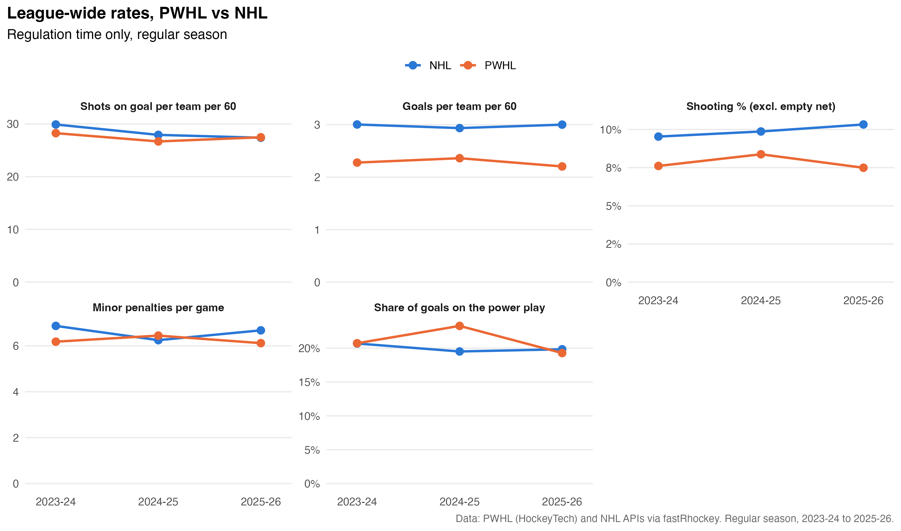
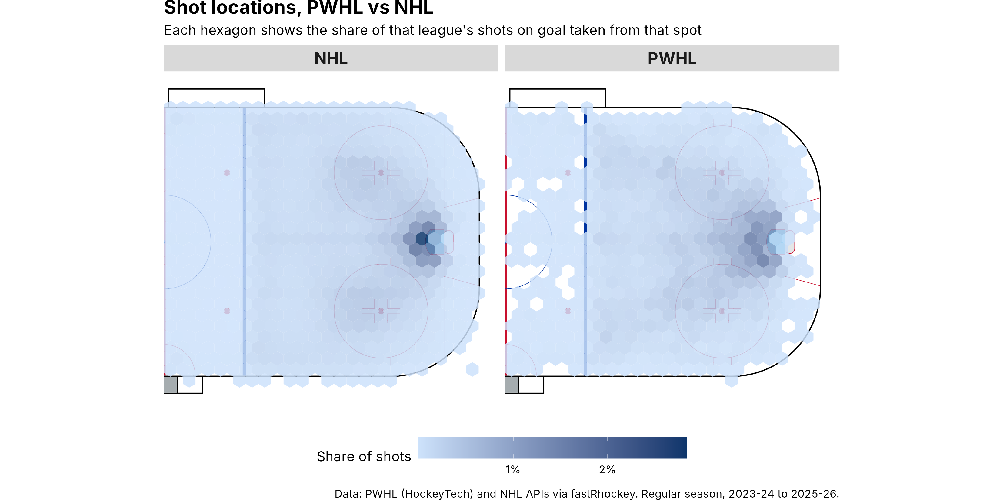
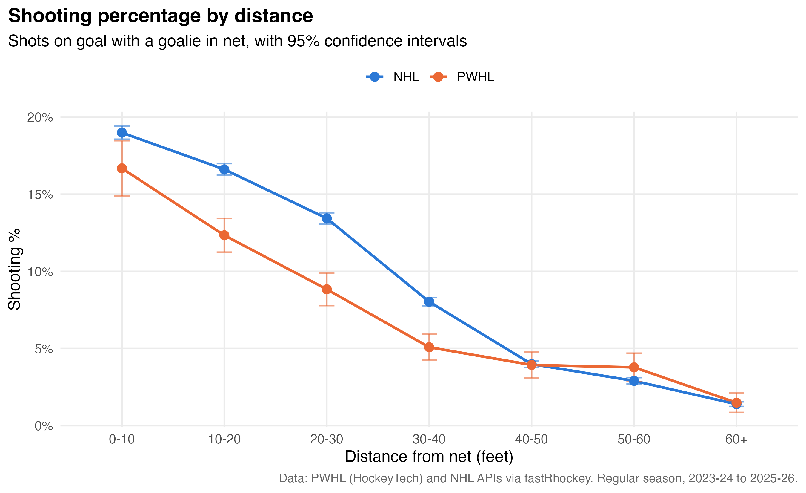
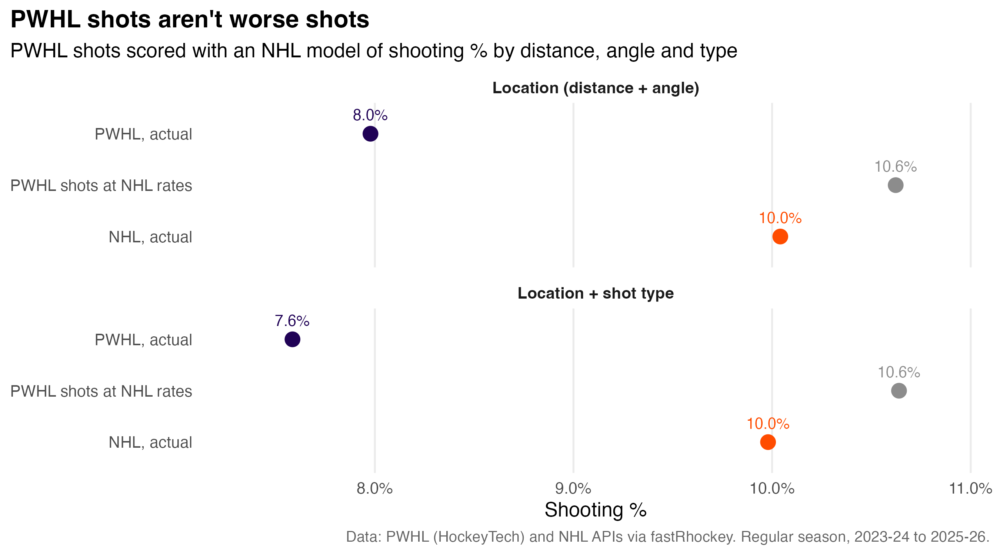
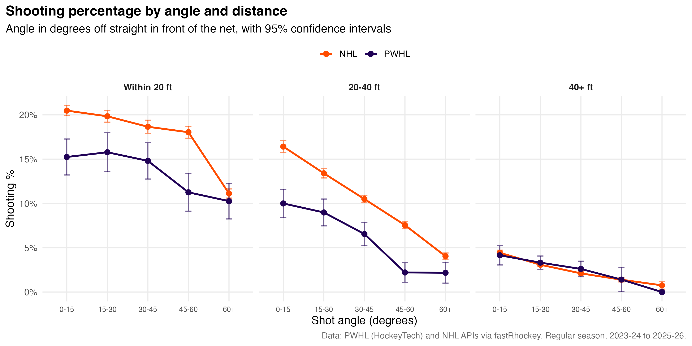
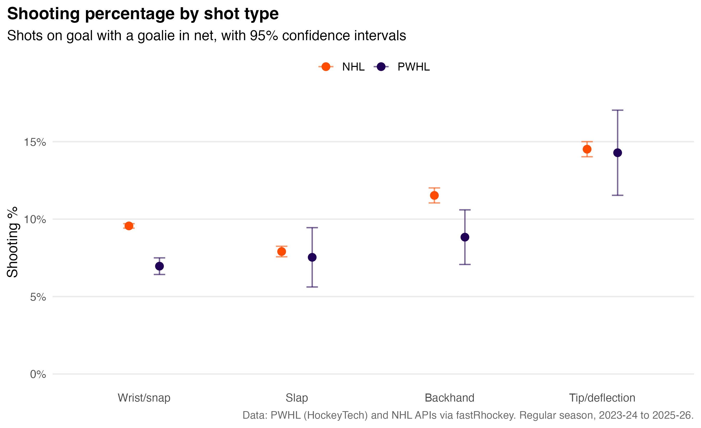

# PWHL vs NHL: how different is the game?

A comparison of the Professional Women's Hockey League and the National Hockey
League across scoring, league-wide rates, shot locations, shot types and angles,
and goaltending, using
every regular-season game from 2023-24 (the PWHL's first season) to 2025-26.

## Key findings

- **Lower scoring, tighter games.** PWHL games average 4.7 goals compared with
  6.1 in the NHL. Half of PWHL games are decided by one goal (NHL: 40%), and
  27% go past regulation (NHL: 22%).
- **Same shot volume.** Teams in both leagues get about 27-28 shots on goal per
  60 minutes. The scoring gap comes from what happens to those shots.
- **Lower shooting percentage.** 7.8% of PWHL shots go in, compared with 9.9%
  in the NHL. Save % is .921 in the PWHL and .900 in the NHL.
- **It isn't shot location.** PWHL teams take about as many shots from within
  20 feet as NHL teams do (33% vs 31% of shots), but convert fewer of them at
  every distance up to 40 feet.
- **It isn't shot angle or shot type either.** PWHL shots come from slightly
  more central angles (54% within 30° of straight on, vs 47% in the NHL), and
  the shot mix is similar. Scored at NHL conversion rates for their distance,
  angle and type, PWHL shots would go in 10.6% of the time, slightly above the
  NHL's actual 10.0%. The whole gap is in finishing (or goaltending), not shot
  selection.
- **The gap is in close and mid-range wrist shots and backhands.** Slap shots
  and tips go in at nearly the same rate in both leagues, and beyond 40 feet
  the two leagues are level. Wrist/snap shots (7.0% vs 9.6%) and backhands
  (8.8% vs 11.5%) account for the difference.
- **Goalies vary about as much.** After adjusting for shot distance, angle and type, the
  spread between the best and worst goalies is similar in both leagues.













## Project structure

```
R/
  00_setup.R         shared packages, seasons, colours, chart theme
  01_load_data.R     downloads data once, saves tidy tables to data/
  02_scoring.R       goals per game, margins, overtime and shootouts
  03_rates.R         shots, goals, shooting %, penalties per 60
  04_shot_maps.R     shot location maps, shooting % by distance
  05_goaltending.R   save %, expected goals model, goals saved above expected
  06_shot_quality.R  shot type and angle, PWHL shots scored at NHL rates
run_all.R            runs everything in order
figures/             saved charts
output/              summary tables (CSV)
```

## How to run

1. Install the packages:
   ```r
   install.packages(c("tidyverse", "fastRhockey", "sportyR", "hexbin"))
   ```
2. Open this folder in Positron (or RStudio) and run `source("run_all.R")`.
   The first run downloads about three seasons of NHL play-by-play and takes a
   few minutes. The data is saved to `data/` (not in the repo).

## Methods and caveats

- **Shots means shots on goal** (saves plus goals). The PWHL doesn't publish
  missed shots, so this is the fairest measure both leagues share.
- **Rates use regulation time only**, so every game counts for exactly 60 minutes.
- **Shot distance** is measured from the centre of the net, with the goal line
  89 feet from centre ice:
  $d = \sqrt{(89 - x)^2 + y^2}$.
- **Shot angle** is degrees off the line straight out from the net:
  $\theta = \arctan\left(|y| / (89 - x)\right)$, so 0° is dead centre and 90°
  is level with the goal line. Wide-angle shots tend to be taken close to the
  net, so shooting % by angle is shown within distance bands.
- **Shot types** are grouped so they mean the same thing in both leagues: wrist
  and snap are combined (scorers split them inconsistently), and tips and
  deflections are combined (the PWHL only records "tip"). About 30% of PWHL
  shots have no recorded type (46% in 2023-24, 21% in 2025-26). Those shots go
  in more often than PWHL wrist shots, so they aren't a random sample. They are
  left out of shot-type comparisons rather than guessed at.
- **"PWHL shots at NHL rates"** fits a logistic regression on NHL shots
  (distance, distance², angle, and optionally shot type), then averages its
  predictions over PWHL shots. It answers: if these exact shots went in as often
  as similar NHL shots, what would PWHL shooting % be?
- **Expected goals** come from a logistic regression on shot distance, angle and
  shot type, fit separately for each league:
  $P(\text{goal}) = 1 / (1 + e^{-(\beta_0 + \beta_1 d + \beta_2 d^2 + \beta_3 \theta + \beta_{\text{type}})})$.
  Goals saved above expected (GSAx) = expected goals against − actual goals against.
  Adding angle and type barely changes goalie rankings compared with a
  distance-only model (correlation above 0.98 in both leagues). The model still
  ignores rebounds, rushes and screens, so treat it as a rough adjustment.
- **PWHL coordinate cleanup.** In a few PWHL games, a team's shots for a period
  are recorded at the wrong end of the rink. These are flipped back in
  `01_load_data.R`.
- **Sample size.** The PWHL has 282 regular-season games in this period vs
  3,936 for the NHL, so PWHL estimates are much less precise. Charts show 95%
  confidence intervals where relevant.

## Data

Play-by-play and schedules from the PWHL (HockeyTech) and NHL APIs, via the
[fastRhockey](https://fastRhockey.sportsdataverse.org/) R package. Rinks drawn
with [sportyR](https://sportyR.sportsdataverse.org/).
